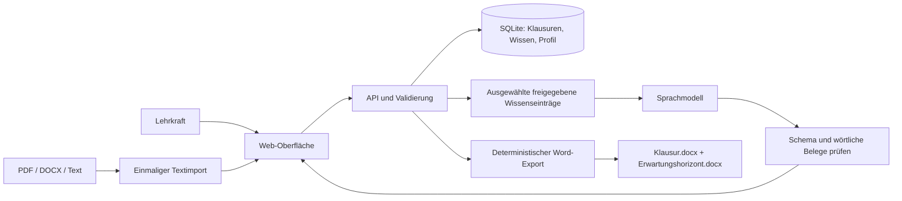

# Architektur und fachliches Wissen

## Produktentscheidung

Klausurwerk beginnt als Web-App. Die Lehrkraft arbeitet mit Material und Tabellen an Schulrechnern, Macs und Tablets und lädt bearbeitbare Word-Dateien herunter. Dieser Arbeitsablauf braucht keine native iOS- oder macOS-App. Die Architektur hält eine spätere mobile Verpackung offen, konzentriert die erste Entwicklung aber auf eine gemeinsame Oberfläche.

React/TypeScript gestaltet die Oberfläche. FastAPI/Python betreibt API, Validierung, Dateiimport und Dokumentenerzeugung. `python-docx` erzeugt Word-Dateien; `pypdf` liest PDF-Inhalte, `pdfplumber` misst vorhandene Schriftdaten und Seitengeometrie. SQLite hält den privaten Arbeitsstand lokal und benötigt keinen zusätzlichen Dienst. Das gebaute Frontend wird vom gleichen Server ausgeliefert; die Browseroberfläche kennt keinen KI-Schlüssel.

## Das Gehirn besteht aus drei Teilen

**1. Verbindliche Regeln und Dokumentvorlagen.** Formatregeln, Punktberechnung und Prüfungen sind Daten und Programmcode. Das Modell entscheidet nicht über Seitenränder oder Schriftgrößen. Der Prototyp hat ein bewusst unbestätigtes Basisprofil. Die konkrete NRW-Vorlage muss erst abgenommen und für die nötigen Prüfungsvarianten implementiert werden. Noch nicht vorhanden sind getrennte komplexe Tabellenlayouts für einzelne amtliche Raster und unterschiedliche Formatprofile pro Dokumentart.

**2. Die redaktionelle Wissensbasis.** Alte Klausuren und Erwartungshorizonte werden beim Import einmal in Text umgewandelt. Die Lehrkraft prüft Lesereihenfolge, entfernt fremde/personenbezogene Angaben und formt daraus brauchbare Regeln oder Beispiele mit Quelle und Gültigkeitsangabe. Anschließend arbeitet die App mit gespeicherten Inhalten. Die Original-PDF muss bei späteren Aufrufen nicht erneut gelesen werden. Eine Wissensquelle wird nicht durch ihre Ablage automatisch zu einer amtlichen Regel; eine persönliche Freigabe ist eine redaktionelle Bewertung.

Im ersten Prototyp wählt die Lehrkraft freigegebene Einträge selbst aus. Das ist bei kleinen Beständen transparent und gut überprüfbar. Noch nicht umgesetzt sind automatische semantische Suche, Aufteilung nach Seiten, dauerhafte Änderungshistorie und quellengenaue Belegzuordnung auf Kriteriumsebene. Bei größerem Bestand folgt ein Index für relevante Textabschnitte mit Metadaten für Kurs, Jahr, Textart und Prüfungsteil. Die PDF-Extraktion bleibt ein Importvorgang.

**3. Das Sprachmodell.** Das Modell formuliert englische Arbeitsaufträge und deutsche Kriterien zum konkreten Text und ausgewählten Wissen. Es liefert strukturierte Daten, keine fertige Word-Datei. Die App prüft Struktur und wörtliche Zitate und übernimmt den Vorschlag erst dann in den Editor. Alles bleibt bearbeitbar. Wissenschaftlich oder didaktisch fragwürdige Schlussfolgerungen lassen sich durch Zitatprüfungen allein nicht ausschließen.

Die fachliche Wissensbasis bleibt damit außerhalb der Modellgewichte editierbar. Eine neue Vorgabe oder Korrektur kann sofort für die nächste Generierung ausgewählt werden. Eigenes Modelltraining wäre erst sinnvoll, wenn genug freigegebene Beispiele und ein aussagekräftiges Prüfset vorliegen. Es ersetzt keine laufend gepflegten Vorgaben.

## Technische Grenzen sind sichtbar

- Ohne `LLM_API_KEY` gibt es manuelle Bearbeitung und den handverfassten Beispieldatensatz, keine vorgetäuschte Generierung.
- Vor dem KI-Aufruf zeigt die Oberfläche die Übertragung an OpenAI an. Nur die ausgewählten Wissenseinträge und der konkrete Text gehen mit.
- Wissenseinträge dürfen nur mit Quellenangabe freigegeben werden. Eine Inhaltsänderung in der Oberfläche hebt die Freigabe auf. Die API prüft bei jeder Generierung, ob die ausgewählten Quellen noch existieren und freigegeben sind.
- Quelleninhalte werden im KI-Auftrag als Daten gekennzeichnet; eine Immunität gegen Prompt-Injection wird nicht behauptet.
- Erfundenen wörtlichen Textbelegen folgt ein Fehler statt einer Übernahme. Inhaltliche Vollständigkeit und vertretbare Alternativantworten prüft die Lehrkraft.
- Die Arbeitsprüfung meldet fehlende Teile und summiert Punkte. Sie zertifiziert keine Abiturkonformität.
- Word-Zeilenumbruch und Paginierung hängen zusätzlich vom Word-Renderer und installierten Schriften ab. Die XML-Einstellungen sind automatisch geprüft. Die Beispielexporte wurden zusätzlich mit LibreOffice als PDF gerendert und visuell geprüft; ein Vergleich mit Microsoft Word und der fachlichen Referenzvorlage steht noch aus.

## Nächste sinnvolle Ausbauschritte

Zuerst folgt die fachliche Abnahme anhand echter Referenzen, mit getrennten Formatvorlagen pro Dokument- und Prüfungsart. Danach entstehen ein dauerhaftes Evaluationsset und eine versionierte Regel- und Wissensverwaltung mit nachvollziehbarem Quellenstand pro Generierung. Weitere Schritte sind Sprachmittlung/Hörverstehen nach bestätigter Zielvariante, eine Aufgabenalternative für AFB III, Anmeldung und getrennte Arbeitsbereiche sowie gesicherter Betrieb für echte Nutzer. Eine größere Suchinfrastruktur wird erst bei wachsendem Quellenbestand ergänzt.

Der Prototyp hat bewusst noch keine öffentliche Mehrbenutzerbereitstellung. Die aktuelle Version speichert die zuletzt bearbeiteten Klausurinhalte und das aktuelle globale Formatprofil; ein vollständig reproduzierbarer historischer Generierungsstand ist ein eigener nächster Entwicklungsschritt.

## Referenz-PDFs und Formatrollen

Die mittlerweile bereitgestellten Beispiele sind in [einem gemeinsamen Beobachtungsbericht](references/nrw-2025-observations.md) mit Seitenverweisen dokumentiert. Der Wunsch des Nutzers ist eine gemeinsame Vorlage, keine aus den Kursbezeichnungen abgeleiteten Layoutvarianten. Die Messfunktion unter `/api/analyze-pdf` und das gleichnamige Kommandozeilenskript unterscheiden ausgelesene PDF-Daten von noch abzuleitenden Word-Einstellungen. Sie verändern weder das Formatprofil noch die fachliche Freigabe. Ein OCR-Durchlauf kann Scantext zugänglich machen, stellt aber verlorene ursprüngliche Schriftdaten nicht wieder her.

Die Beispiele zeigen, dass das globale Einfachprofil um Formatrollen für Aufgaben, Ausgangstext, ausführliche Anforderungen, kompakten Bewertungsbogen und Kopf-/Fußzeilen erweitert werden muss. Diese Umstellung sowie Wahlaufgaben und die Trennung von Anforderungsraster und Bewertungsbogen sind noch nicht implementiert. Die gemeinsame referenzbasierte Vorlage ist damit ein konkreter nächster Entwicklungsschritt, keine bereits zugesicherte Eigenschaft des bisherigen Exports.
